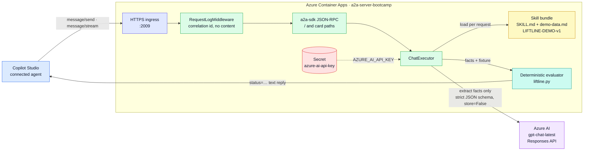
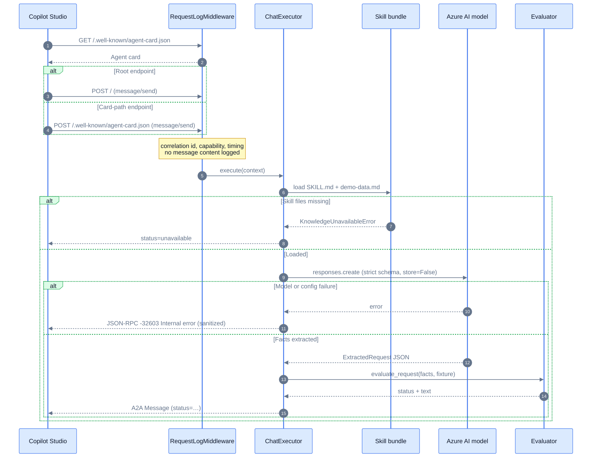
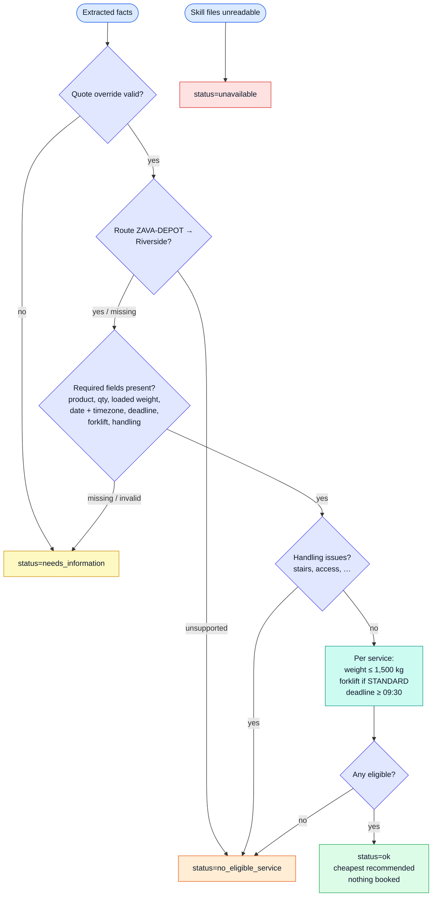
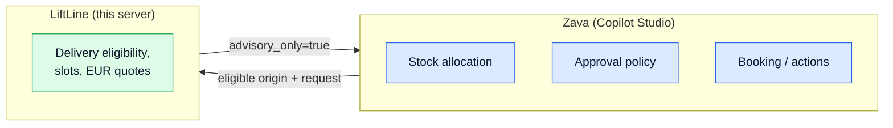
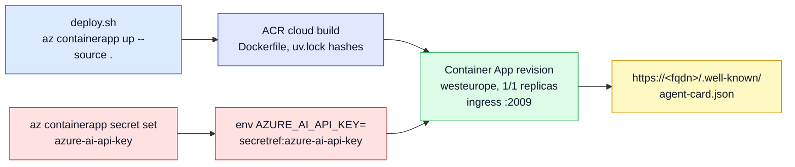

# LiftLine Dispatch Advisor

Fictional LiftLine delivery advisor exposed over [A2A](https://a2a-protocol.org) v0.3.0
(JSON-RPC over HTTP) for the Zava demo, built to be added as a **connected A2A agent in
Copilot Studio**. Python 3.12 / UV, `a2a-sdk` Starlette app on port `2009`.

It uses Azure AI `gpt-chat-latest` to interpret delegated natural-language requests, then
evaluates eligibility and prices deterministically against the separately loaded synthetic Skill
fixture.

LiftLine evaluates delivery only. Zava independently owns stock allocation and approval policy.
The agent never books, reserves, purchases, sends messages, updates inventory, or calls business
systems. All availability, prices, and recommendations are fictional and advisory.

**Live:** `https://a2a-server-bootcamp.gentleplant-daa79337.westeurope.azurecontainerapps.io/.well-known/agent-card.json`

| Endpoint | Purpose |
|---|---|
| `GET /.well-known/agent-card.json` | Agent card (legacy `/.well-known/agent.json` also served) |
| `POST /` | JSON-RPC: `message/send`, `message/stream` |
| `POST /.well-known/agent-card.json` or `POST /.well-known/agent.json` | Same JSON-RPC handler, for connections that send messages to the discovery URL |
| `GET /` | `405 Method Not Allowed` by design |

## Architecture

*Request path from Copilot Studio to a deterministic, advisory reply.*



### One `message/send` request

*End to end, including the card-path POST that Copilot Studio may use.*



### Evaluation rules

*The model never decides eligibility or price; Python does, from the loaded fixture.*



### Responsibility boundary

*LiftLine advises on delivery; Zava keeps every business decision.*



## Bundled Skill and fixture

- `liftline-dispatch/SKILL.md` contains the dispatch playbook and response rules.
- `liftline-dispatch/references/demo-data.md` contains fixture `LIFTLINE-DEMO-v1`.
- The server reads both files for each evaluation. If either is missing or unreadable, it returns
  `status=unavailable`; it does not substitute model knowledge or remembered prices.
- The model extracts request facts only (OpenAI v1 Responses API, strict JSON schema,
  `store=False`). Python validates required fields and applies the route, weight/capacity,
  forklift, handling, slot, deadline, and price rules from the loaded fixture.
- Model or configuration failures return JSON-RPC `-32603 Internal error`; logs record only the
  error type and correlation ID, never exception text, content, or credentials.

Application response statuses are `ok`, `needs_information`, `no_eligible_service`, and
`unavailable`. They are text conventions inside A2A messages, not new A2A wire types.

## Run locally

```bash
uv sync
cp .env.example .env
```

Set `AZURE_AI_API_KEY` in the ignored `.env` file using a rotated key. Do not put credentials in
source, commits, logs, or prompts. Then run:

```bash
uv run main.py        # http://localhost:2009
```

If direct PyPI access is blocked on your machine, point uv at your approved mirror: `UV_DEFAULT_INDEX=<mirror simple URL> uv sync`.

The model endpoint and deployment default to the configured workshop Azure AI project and
`gpt-chat-latest`; override with `AZURE_AI_ENDPOINT` and `AZURE_AI_MODEL`. The API key is read
only from `AZURE_AI_API_KEY`. Request logs include a correlation ID, A2A capability, fixture,
result status, HTTP status, and timing; they do not log message contents or credentials.

## Test

```bash
uv run pytest                                                   # 39 tests, model mocked
uv run python scripts/test_live.py --base-url https://<fqdn>    # or A2A_E2E_URL=https://<fqdn>
```

The local suite mocks model extraction and checks the evaluator without requiring an Azure key.
The live script validates the agent card and exercises success, clarification, and no-eligible
responses through the root endpoint and card-path POST route. A deployed app must have a
rotated key configured before the live model checks can pass.

## Deploy to Azure Container Apps

*`deploy.sh` cloud-builds the Dockerfile; the model key is attached separately as a secret.*



```bash
az login
AZURE_SUBSCRIPTION_ID=<id> ./deploy.sh
```

Creates (or updates) resource group `rg-a2a-server-bootcamp`, container registry, environment and
container app `a2a-server-bootcamp` in `westeurope` from the `Dockerfile` (cloud build, no local
Docker needed), pins replicas to 1, and prints the agent card URL. Settings live in `.env`, see
`.env.example`. The card URL is derived from the Container Apps environment, so no
`PUBLIC_BASE_URL` is needed.

The image installs hash-pinned dependencies exported from `uv.lock`, so it builds against the default package index even if the lockfile was resolved through a mirror.

For Azure runtime model access, store a **rotated** Azure AI API key as a Container App secret
and map `AZURE_AI_API_KEY` to it. Never pass the key as a plain environment value or add it to
`deploy.sh`.

```bash
az containerapp secret set -n a2a-server-bootcamp -g rg-a2a-server-bootcamp \
  --secrets azure-ai-api-key=<key>
az containerapp update -n a2a-server-bootcamp -g rg-a2a-server-bootcamp \
  --set-env-vars AZURE_AI_API_KEY=secretref:azure-ai-api-key
```

Logs: `az containerapp logs show -n a2a-server-bootcamp -g rg-a2a-server-bootcamp --follow`

## Connect from Copilot Studio

1. Open your agent, then **Build** → **Connected agents** → **Add** → **Add A2A agent**.
2. Agent card URL: `https://<fqdn>/.well-known/agent-card.json` (name and description fill in automatically).
3. Authentication: **None**, then **Create connection** and **Add**.
4. Test in the Preview pane: "Hello", "What can you do?", then a few follow-up messages.

The card advertises the root URL as the message endpoint, but Copilot Studio derives the endpoint
from the card URL and POSTs there. Both card paths therefore accept JSON-RPC directly, without a
redirect (this fixed a `405 Method Not Allowed`). GET on either path still returns the agent card.

## Configuration

| Variable | Default | Purpose |
|---|---|---|
| `PORT` | `2009` | Listen port |
| `LOG_LEVEL` | `INFO` | Log level |
| `AGENT_NAME` | `LiftLine Dispatch Advisor` | Name on the agent card |
| `AGENT_DESCRIPTION` | built in | LiftLine purpose and responsibility boundary on the card |
| `PUBLIC_BASE_URL` | auto | URL advertised in the card; auto-detected on Container Apps, else `http://localhost:$PORT/` |
| `AZURE_AI_ENDPOINT` | workshop Azure AI OpenAI v1 endpoint | OpenAI-compatible Azure AI model endpoint |
| `AZURE_AI_MODEL` | `gpt-chat-latest` | Azure AI deployment name |
| `AZURE_AI_API_KEY` | unset | Required model credential; supply via local ignored `.env` or Azure secret reference |
